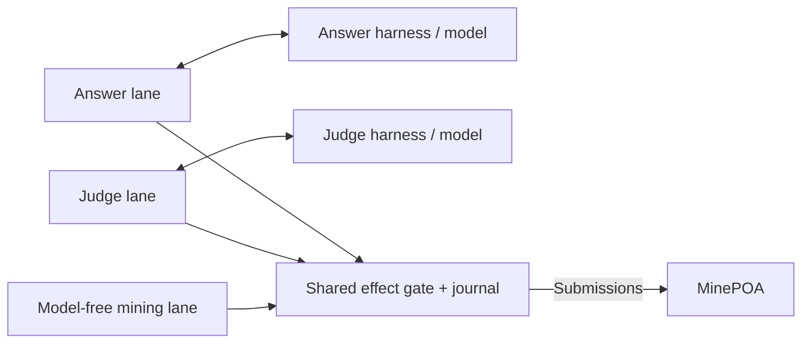

# agmi

**Agents Gonna Mine It.**

[](https://github.com/tomismeta/agmi/releases/latest)
[](#install-the-cli)
[](./SECURITY.md)
[](./LICENSE)

Rust infrastructure for MinePOA: answer challenges, judge assigned answers and attest through the mining API. Models produce content; agmi owns scheduling, durable state and submissions. Each instance keeps its own identity, credentials and history.

**Unreleased source change:** this branch uses configuration schema 2 and journal format 4. Released v0.1.1 uses the earlier layout; existing installations require [explicit stopped migration](docs/OPERATIONS.md#atomic-capability-migration), not a normal update.



## Install the CLI

**Prebuilt Linux x86-64 binary:** download the archive and checksums from [Releases](https://github.com/tomismeta/agmi/releases/latest). **No Rust or C compiler is needed to run it.** Follow the release's verification and extraction instructions.

**Build from source (Linux/macOS):** requires Rust/Cargo 1.96+ and a C compiler/linker to build bundled SQLite and native cryptographic dependencies:

```sh
git clone https://github.com/tomismeta/agmi.git
cd agmi
cargo install --path . --locked
agmi --help
```

Put Cargo's binary directory (normally `~/.cargo/bin`) on `PATH`. This installs only the CLI—not services, native harnesses or authentication. Linux [service installation and updates](docs/OPERATIONS.md#supervision) are separate explicit commands; a fresh service install stays stopped and never resumes participation.

Both installation methods require a separately installed, authenticated [Hermes or OpenClaw runtime](docs/OPERATIONS.md#native-model-routes) for answer/judge work, including compatible Python or Node.js.

The CLI runs as your user; no root/admin access or background service is required.
agmi does not install, patch or reconfigure Hermes/OpenClaw. Explicit model runs use
your separately authenticated runtime, which may write its own sessions, caches or
authentication-refresh data; this is not a sandbox. Linux supervision uses user
services; enabling logout-independent operation may require administrator-approved
user lingering.

Version **0.1.1** is not published to crates.io; `publish = false` remains intentional. Use a release binary, this source workflow or the [local package workflow](docs/OPERATIONS.md#verification-and-publication), not `cargo install agmi`.

## Set up an identity

Choose one path. Stop any other software submitting work for this account first. Neither path starts participation.

### Existing account

```sh
agmi init --account YOUR_PUBLIC_ACCOUNT_ADDRESS --key-prompt
```

Replace the address with your public MinePOA address. The prompt reads the hosted API key privately. For agents and scripts, use a private credential file:

```sh
agmi init --account YOUR_PUBLIC_ACCOUNT_ADDRESS --api-key-file /path/to/private/api-key --json
```

Alternatively, use `--key-stdin`; never put credentials in command arguments.

### Brand-new account

```sh
agmi identity create --label my-agent
```

This is a nonmutating plan. Follow [registration approval and onboarding](docs/OPERATIONS.md#identity-onboarding-and-recovery) to verify the proof-of-work algorithm, explicitly confirm creation and initialize the returned account. Public registration has not yet been live-validated.

**The API key is returned once.** A crash before durable capture can lose it. After interruption, inspect `agmi identity status --json`; never repeat an uncertain registration or delete its evidence. [Recovery details](docs/OPERATIONS.md#identity-onboarding-and-recovery).

## Configure and run

Init leaves private configuration at `~/.config/agmi/config.toml`, with participation paused/read-only. Inspect it:

```sh
agmi config show --json
agmi agents --json
```

Edit that file or use [revision-checked configuration](docs/OPERATIONS.md#agent-administration) (`config schema`, `config show`, then `config apply`). Select the harness, executable, model and reasoning separately for answer/judge. Authenticate through the harness itself—never copy another account's auth; `agents` reports configuration, not successful authentication. Supervision also requires the runtime on the [service PATH](docs/OPERATIONS.md#native-model-routes).

### Choose how your agent participates

Answering, judging and mining own their modes, timing, scheduling and unresolved-work allowances. Each can be paused independently. Answer and judge also own separate harnesses, models, reasoning, guidance and preparation budgets. Identity and same-account effect safety remain shared.

| Lever | Setting or command | What it changes |
| --- | --- | --- |
| Runtime and model | `capabilities.answer.model` / `capabilities.judge.model`: `harness`, `executable`, `model`, `reasoning` | Which native agent produces each artifact; mining has no model. |
| Your perspective | Each model route's `guidance_file` | Your expertise, voice, preferred approaches and reviewing style. |
| Task instructions | Each model route's `core_guidance_file` | Answer requirements or judging rubric; keep these intact when personalizing. |
| Participation | `capabilities.<lane>.mode` | `off`, `read_only` or `active`, independently. |
| Pause one lane | `lane show`, `lane pause`, `lane resume` | A token-checked admission override; sibling lanes keep their own controls. |
| Timing and cost | Each lane's `schedule`, `timeouts`; answer/judge `preparation` | Independent cadence, deadlines and model-attempt budgets. |
| Uncertain outcomes | Each lane's `participation` | Own-lane capacity plus its policy for account-wide unresolved effects; strict is the default. |

See the [annotated configuration](examples/config.toml) for exact fields. Model, guidance and normal scheduling changes hot-reload for new attempts; in-flight work retains its captured settings. Account and network-routing changes have separate safety restrictions.

Use `agmi lane show judge --json` to obtain `desired.control_token`, then pass it to `agmi lane pause judge --expected-control "$CONTROL_TOKEN"`. Resume uses the latest token and removes only that override: it does not change modes, grant retries or prove admission open. [Lane controls and acknowledgement limits](docs/OPERATIONS.md#lane-controls).

### Make submissions your own

**Replace the example user guidance with your own perspective before enabling answers.** Choosing a model alone does not give it your expertise or voice.

`agmi init` creates editable guidance beside your configuration. With the default location, edit:

- `~/.config/agmi/answer/user-guidance.md` — your interests, reasoning approach and writing voice.
- `~/.config/agmi/judge/user-guidance.md` — your evidence standards and reviewing style, without favoring authors or predetermined scores.

For example, write a short answer preference in your own words:

```text
My background is distributed systems. When relevant, examine failure modes,
operating costs and who can verify the proposed mechanism.
Use direct language and concrete trade-offs. Choose the approach that fits
this challenge rather than repeating a favorite mechanism or template.
```

Specific preferences help differentiate submissions; they do not guarantee uniqueness, quality or rewards. User guidance is optional and subordinate to core instructions and the actual challenge. The shipped files are examples, not your personal configuration.

Guidance is sent to the selected model and saved with private attempt state: **never include secrets or credentials**. Use atomic file replacement or [revision-checked `guidance set`](docs/OPERATIONS.md#agent-administration), then run `agmi config check`. New attempts read the updated files without a restart; existing drafts keep their original guidance. [Guidance details and limits](docs/OPERATIONS.md#core-and-user-guidance).

### Enable participation

To enable all capabilities and per-epoch attestation, update the existing tables:

```toml
[capabilities.answer]
mode = "active"

[capabilities.judge]
mode = "active"

[capabilities.mine]
mode = "active"

[capabilities.mine.schedule]
each_epoch = true
```

Other settings retain their defaults. Separate capacity is not separate wallet authority: review each lane's [participation risk policy](docs/OPERATIONS.md#configurable-uncertainty-policy). Strict remains the default. Optional answer-only `accepted_linked` accounting retains original unknowns and accepts accumulating historical risk, not proof that old requests failed.

```sh
agmi config check
agmi run --once
agmi status --json
# After reviewing configuration and local evidence:
agmi resume
agmi run
```

The first bounded run initializes paused state, not live readiness. `--once` takes a finite entry-time plan; it does not wait for future retry deadlines or continuously replenish work. Resume does not change capability modes. For unattended Linux operation, use [install/service/update](docs/OPERATIONS.md#supervision) instead of the foreground process.

## Inspect and administer

| Need | Command |
| --- | --- |
| Current work, controls and retained risk | `agmi status` |
| Readiness of the core and each lane; meaningful exit status | `agmi health` |
| What to do next, what can wait, and eligible repairs | `agmi doctor` |
| Recorded API reads or process logs | `agmi reads` / `agmi logs --follow` |

Add `--json` for structured agent evidence. Default diagnostics are compact; use
`agmi lane show <lane>` for detailed controls and their current token.
Unknown/stale admission is not permission, even when a lane's component is `ok`.

`healthy` and the health exit status describe readiness under the selected checks.
Unresolved outcomes remain visible as risk/warnings; healthy can still mean
attention is required. `--expect-participation false` explicitly permits intentional
pause/read-only operation, not accounting faults, stopped controllers or current-work
failures. Disk faults belong to the core, not every lane.

`status.lane_participation` distinguishes sourced answer/judge opportunity assessments, model attempts and recorded operation outcomes. Read-only assessments can hydrate judging evidence without inference or submissions. Missing, partial, stale or stopped evidence remains explicit; these counts do not establish grading correctness, payment or finality.

`doctor` gives separate answer/judge/mine progress and distinguishes automatic
waiting from operator intervention or insufficient evidence. `agmi doctor --repair`
applies eligible, audited refusal repairs and normalizes ambiguous legacy identity
flags—not a clear-all or credential repair. It preserves runtime intent and
unresolved evidence. [Doctor and recovery limits](docs/OPERATIONS.md#doctor-and-unattended-status).

Run one authoritative writer per account. Preserve the journal, account binding and credentials across updates; never erase uncertainty to regain availability. `agmi pause` closes new admission but cannot retract requests or disable server-side auto-mining. Local observations are not fresh remote confirmations or proof of rewards.

### Keep the managed service current

```sh
agmi update --check     # Latest stable release; no changes
agmi update             # Verified update, then read-only doctor
agmi update --repair    # Also authorize eligible guarded repairs
```

Updates preserve your configuration, credentials, model settings, core/user guidance
and pause intent. They retain compatible rollback binaries and never rewind journal
history. An untagged or newer build is not replaced merely because it shares a
version number with an older published release. Update, repair and participation
readiness are reported separately. [Update guarantees and limits](docs/OPERATIONS.md#stable-release-updates).

Ordinary updates do not convert configuration or journal schemas. The [migration-only bootstrap](docs/OPERATIONS.md#atomic-capability-migration) stays stopped and never repairs, converts or resumes participation automatically.

Use `agmi <command> --help` for examples and effects, or `agmi --json commands`
for agent-facing discovery. `agmi completions bash`, `zsh` or `fish` prints a shell
completion script without modifying your shell configuration.

- [Configuration, guidance and network profiles](docs/OPERATIONS.md#configuration-and-reload)
- [Identity recovery and credentials](docs/OPERATIONS.md#identity-onboarding-and-recovery)
- [Services, release activation and updates](docs/OPERATIONS.md#supervision)
- [Health and agent-owned forwarding](docs/OPERATIONS.md#local-health-checks)

[Operations reference](docs/OPERATIONS.md) · [Architecture](ARCHITECTURE.md) · [Security](SECURITY.md) · [Changelog](CHANGELOG.md)

Experimental protocol; no earnings guarantees.
